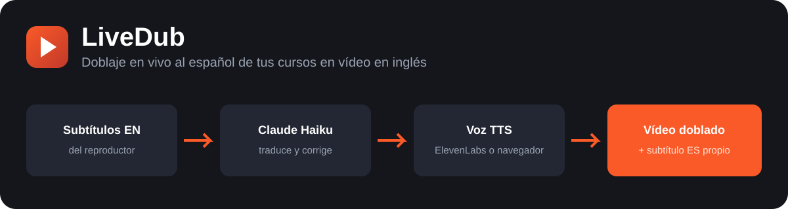

  
  
  
  
  

<b>ES</b> · <a href="#english">EN</a>

# LiveDub — doblaje en vivo al español

Extensión de Chrome que **dobla al español, casi en tiempo real, cursos en vídeo en inglés**. Lee los subtítulos en inglés del reproductor, los traduce con **Claude** y los locuta con **ElevenLabs** (o con la voz gratuita del navegador), bajando el volumen del vídeo original. Pensada para cursos como los de Awwwards Academy.

## Por qué

Los subtítulos automáticos en español de las plataformas suelen ser malos. Aquí se parte del **inglés** y se traduce con un prompt que sabe que el texto viene de reconocimiento automático y corrige errores por contexto («playing jazz it» → «plain JavaScript»).

## Características

- **Lee los subtítulos en inglés aunque el CC esté apagado** (reproductores Video.js; resto de sitios por `textTracks` o por el DOM).
- **Traducción con Claude** (Haiku 4.5 por defecto, Sonnet opcional), con 90 s de antelación y contexto de las frases vecinas.
- **Dos voces**: ElevenLabs (calidad) o voz del navegador (gratis). Interruptor para alternar sin borrar claves; si ElevenLabs falla, se desactiva y se recuerda.
- **Subtítulo en español propio** sobre el vídeo, personalizable: tamaño, opacidad, fuente, posición, ancho y negrita.
- **Caché local** (IndexedDB): no repites gasto de tokens ni créditos al rebobinar o recargar.
- **Sincronizado**: pausa, seek y ducking del audio original; funciona en pantalla completa.
- **Errores explicados**: cada fallo dice qué ha pasado y qué hacer.
- **Sin servidor, sin telemetría, sin dependencias.** Tus claves solo viven en `chrome.storage.local`.

## Instalación (2 minutos)

1. Descarga el ZIP de la [última release](../../releases/latest) y descomprímelo (o clona el repo y usa la carpeta `extension/`).
2. Abre `chrome://extensions` y activa **Modo desarrollador**.
3. **Cargar descomprimida** → elige la carpeta `extension/`.
4. Haz clic en el icono de la extensión y pega tu **API key de Anthropic**. (Opcional: API key de ElevenLabs y Voice ID.)
5. Pulsa **Probar traducción** y **Guardar todo**.

## Uso

1. Abre la lección y pulsa el botón naranja **«ES ▸ off»** sobre el vídeo → pasa a **«ES ▸ on»**.
2. Dale a play. El botón **🔊/🔈** alterna ElevenLabs y la voz del navegador.
3. Ajusta voz, modelo y aspecto del subtítulo en los ajustes.

## Costes

Usas **tus propias claves**. Haiku es muy barato (céntimos por hora de vídeo) y la caché evita pagar dos veces la misma frase. ElevenLabs consume créditos de tu plan; sin ElevenLabs el coste de voz es cero.

## Privacidad y uso responsable

- Las claves se guardan solo en tu navegador. El texto de los subtítulos se envía a Anthropic (traducción) y, si lo activas, a ElevenLabs (voz). No hay ningún otro servidor.
- Úsala para **uso personal en contenido al que tienes acceso legítimo**. No redistribuyas ni grabes material de terceros doblado. Respeta los términos de cada plataforma.
- Con el plan gratuito de ElevenLabs, las voces clonadas no se pueden usar por API (error 401); usa una voz de la biblioteca.

## Solución de problemas

- **No suena nada**: comprueba que el botón dice «on». Abre la consola (F12), filtra por `DobES` y busca «subtítulo detectado».
- **Suena la voz del navegador en vez de ElevenLabs**: ElevenLabs falló y se desactivó. Mira el aviso junto al botón o «Probar ElevenLabs» en los ajustes.
- **Actualizar**: sustituye los archivos de la misma carpeta cargada en Chrome, pulsa ↻ en `chrome://extensions` y recarga la página.

## Hoja de ruta

- [ ] Modo por captura de audio (para vídeos sin subtítulos): tabCapture + STT en streaming.
- [ ] Selectores por sitio para más plataformas.
- [ ] Más estilos de subtítulo (borde, color de fondo).
- [ ] Voz local gratuita de mejor calidad.
- [ ] Publicar en Chrome Web Store.

Más detalle de cambios en el [CHANGELOG](CHANGELOG.md). ¿Ideas o fallos? Abre un [issue](../../issues). Guía de contribución en [CONTRIBUTING.md](CONTRIBUTING.md).

## Licencia

[MIT](LICENSE) © Douglas Ortega

---

# LiveDub — live Spanish dubbing (EN)

A Chrome (Manifest V3) extension that **dubs English video courses into Spanish in near real time**. It reads the player's English subtitles, translates them with **Claude**, and speaks them with **ElevenLabs** or the free browser voice, ducking the original audio. Built for courses like Awwwards Academy.

**Highlights:** reads English tracks even with CC off (Video.js) · context-aware translation that fixes auto-caption errors · ElevenLabs / browser voice switch with remembered failures · customizable on-screen Spanish subtitle · local cache to avoid re-spending tokens and credits · zero dependencies, no server, keys stay in `chrome.storage.local`.

**Install:** download the ZIP from the [latest release](../../releases/latest) (or clone), open `chrome://extensions`, enable *Developer mode*, *Load unpacked* → select `extension/`, then paste your Anthropic API key in the extension options (ElevenLabs key + Voice ID optional).

**Use responsibly:** personal use on content you are entitled to watch; don't redistribute dubbed third-party material; follow each platform's terms.

Licensed under [MIT](LICENSE).
